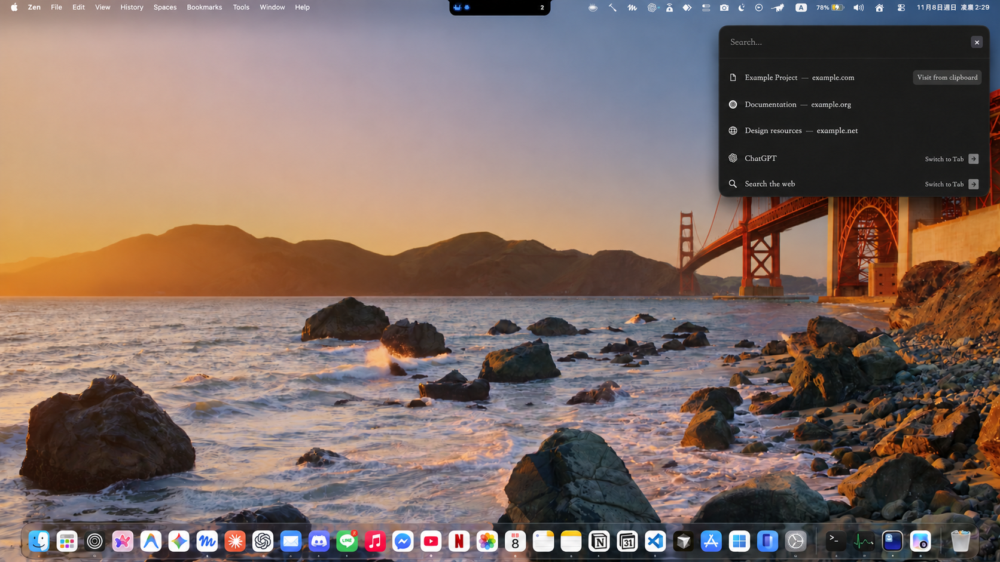
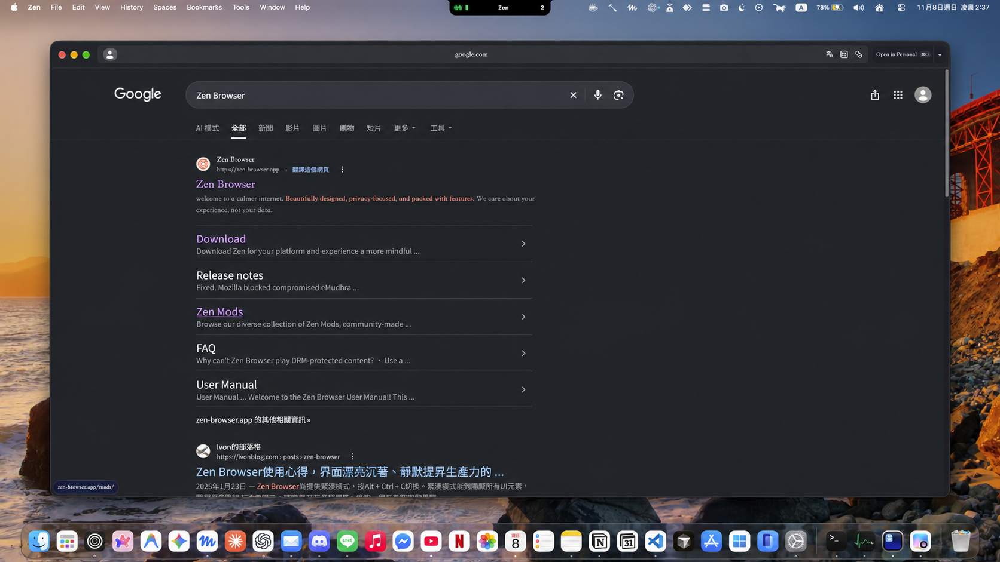

<div align="center">

# Little Zen

A Little Arc-inspired search and browsing window for Zen Browser on macOS.

English · [繁體中文](README.zh-TW.md)

</div>

Open Little Zen with a shortcut, search or enter a URL, and browse in a compact window. Use **Open in Space** to move the page to your main Zen window.



<sub>Search suggestions and profile details were edited for privacy.</sub>

## Installation

> [!IMPORTANT]
> A first-time installer is not available yet. The current files support updates to an existing setup only. See [setup and maintenance](docs/SETUP.md).

Little Zen currently requires macOS, Zen Browser, a compatible userChromeJS loader, and Hammerspoon for the global shortcut. The current setup was tested with Zen 1.24b.

## Usage

| Action | Default shortcut | Availability |
| --- | --- | --- |
| Open Little Zen | `⌘⌥N` | When Zen is active |
| Open Little Zen globally | `⌘⌥⇧N` | Any app, with Hammerspoon running |
| Close the search panel | `Esc` | Search panel |



The global shortcut can be changed in Hammerspoon; see [shortcut configuration](docs/SETUP.md#customize-the-global-shortcut). The Zen-local shortcut is currently fixed in the browser script.

## Features

- Search and open URLs using Zen's address bar.
- Open supported external links in Little Zen.
- Use the current Zen Space and its container when available.
- Move a page to the main Zen window with **Open in Space**.
- Switch to an existing tab, including across Spaces when the target can be identified.
- Open the search panel and browsing window on the display containing the pointer.
- Use native macOS window controls and a Back button when a previous page is available.

Zen supplies search suggestions; depending on its settings, they may include browsing history and open tabs. Spaces organize tabs, while containers keep website identities and data separate.

## Troubleshooting

- **The global shortcut does nothing:** check that Hammerspoon is running, its bridge is loaded, Accessibility permission is enabled, and the shortcut is not in use elsewhere.
- **The shortcut stops working after a Zen update:** check that the userChromeJS loader and Little Zen files are still present. Zen updates can change internal APIs or replace the loader.
- **A page uses the wrong account:** check the container configured for that Space in Zen.

For setup, updates and restoring browser files, see [setup and maintenance](docs/SETUP.md). For implementation and diagnostics, see [architecture](docs/ARCHITECTURE.md). Diagnostic logging can include URLs; inspect and redact logs before sharing them.

## Development

With Node.js and LuaJIT installed, run:

```sh
node --check candidate/littleZen.uc.js
node --test tests/*.test.cjs
luajit tests/bridge.test.lua
luajit tests/focus-return.test.lua
```

These checks do not replace testing in Zen with real Spaces, external links and displays.

## Credits

Built on [wahyuabrory/little-zen](https://github.com/wahyuabrory/little-zen), which credits [12th-devs/little-zen](https://github.com/12th-devs/little-zen). Inspired by Little Arc.
