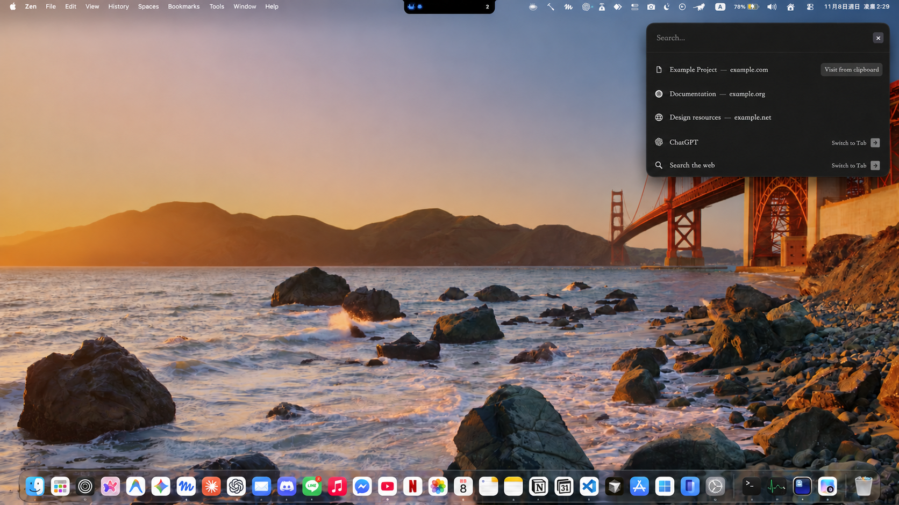
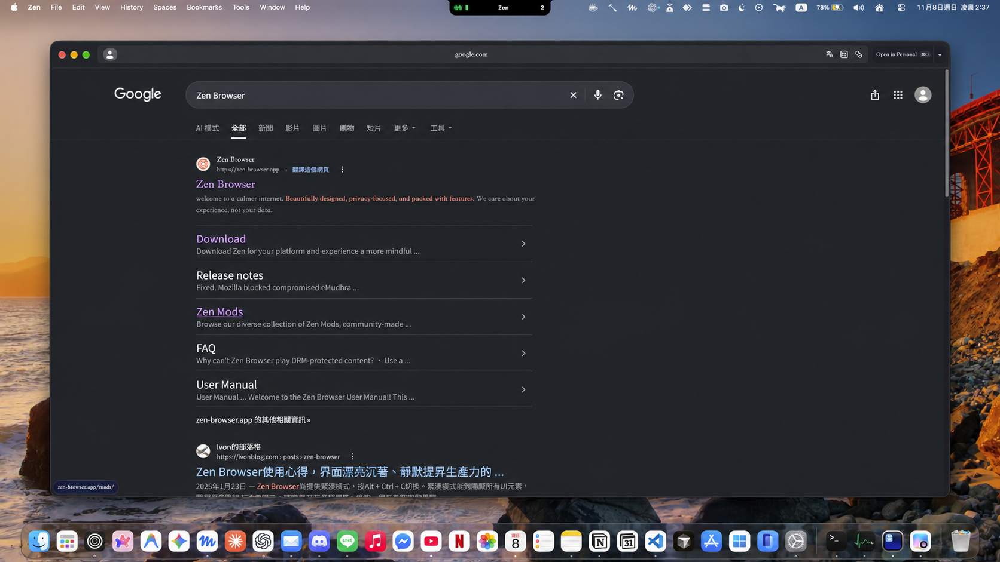

<div align="center">

# Little Zen

受 Little Arc 啟發的 Zen Browser 搜尋與瀏覽小視窗，適用於 macOS。

[English](README.md) · 繁體中文

</div>

按下快捷鍵開啟 Little Zen，輸入搜尋內容或網址，再用小視窗瀏覽。按 **Open in Space** 可將網頁移到 Zen 主視窗。



<sub>截圖中的搜尋建議與個人資訊經編輯以保護隱私。</sub>

## 安裝

> [!IMPORTANT]
> 首次安裝程式尚未提供。目前的檔案僅支援更新已完成設定的環境，請參考[設定與維護](docs/SETUP.md)。

Little Zen 目前以 Apple Silicon Mac 為目標，需要 macOS、Zen Browser、相容的 userChromeJS 載入器，以及用來提供全域快捷鍵的 Hammerspoon。目前的設定已在 Zen 1.24b 測試。

## 使用方式

| 功能 | 預設快捷鍵 | 使用情境 |
| --- | --- | --- |
| 開啟 Little Zen | `⌘⌥N` | Zen 在前景 |
| 全域開啟 Little Zen | `⌘⌥⇧N` | Hammerspoon 執行中，可在其他 App 使用 |
| 關閉搜尋框 | `Esc` | 搜尋框 |



全域快捷鍵可以在 Hammerspoon 修改，請參考[快捷鍵設定](docs/SETUP.md#customize-the-global-shortcut)。Zen 內的快捷鍵目前寫在瀏覽器程式中。

## 功能

- 使用 Zen 的網址列搜尋及開啟網址。
- 在 Little Zen 開啟支援的外部連結。
- 在可取得資訊時，使用目前 Zen Space 對應的 container。
- 使用 **Open in Space** 將網頁移到 Zen 主視窗。
- 在可識別目標時，切換到已開啟的分頁，包括其他 Space 的分頁。
- 在游標所在的螢幕開啟搜尋框與瀏覽視窗。
- 使用 macOS 原生視窗控制按鈕，並在有上一頁時顯示返回鍵。

搜尋建議由 Zen 提供，依設定可能包含瀏覽紀錄和已開啟的分頁。Space 用來整理分頁；container 用來區隔網站身分與資料。

## 疑難排解

- **全域快捷鍵沒有反應：**確認 Hammerspoon 正在執行、橋接模組已載入、已允許輔助使用權限，且快捷鍵沒有被其他程式使用。
- **更新 Zen 後快捷鍵無法使用：**確認 userChromeJS 載入器和 Little Zen 檔案仍然存在。Zen 更新可能改變內部介面或替換載入器。
- **網頁使用錯誤的帳號：**檢查 Zen 中該 Space 設定的 container。

設定、更新與還原瀏覽器檔案請參考[設定與維護](docs/SETUP.md)；實作與診斷資訊請參考[架構說明](docs/ARCHITECTURE.md)。診斷紀錄可能包含網址，分享前請先檢查並遮蔽敏感資訊。

## 開發

安裝 Node.js 和 LuaJIT 後，執行：

```sh
node --check candidate/littleZen.uc.js
node --test tests/*.test.cjs
luajit tests/bridge.test.lua
luajit tests/focus-return.test.lua
```

這些檢查不能取代在 Zen 中使用實際 Space、外部連結及多螢幕的測試。

## 致謝

本專案基於 [wahyuabrory/little-zen](https://github.com/wahyuabrory/little-zen)，該專案引用了 [12th-devs/little-zen](https://github.com/12th-devs/little-zen)。靈感來自 Little Arc。
